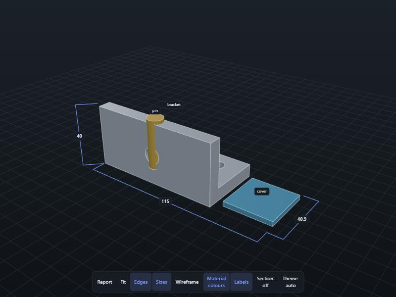
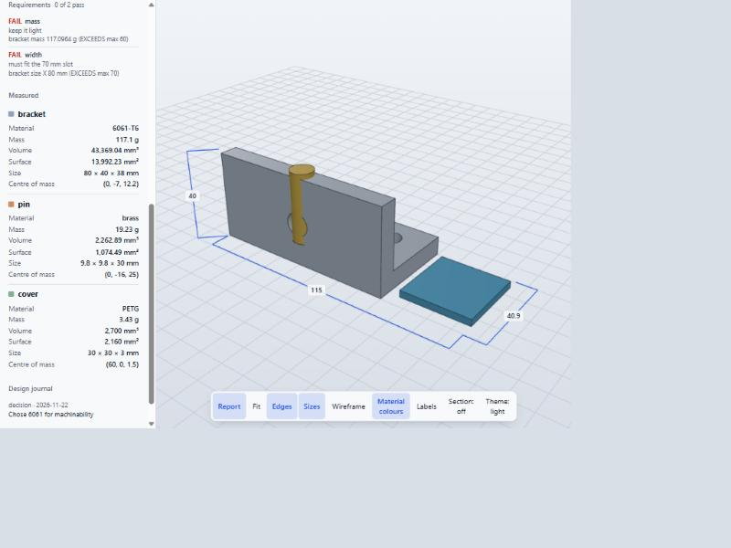
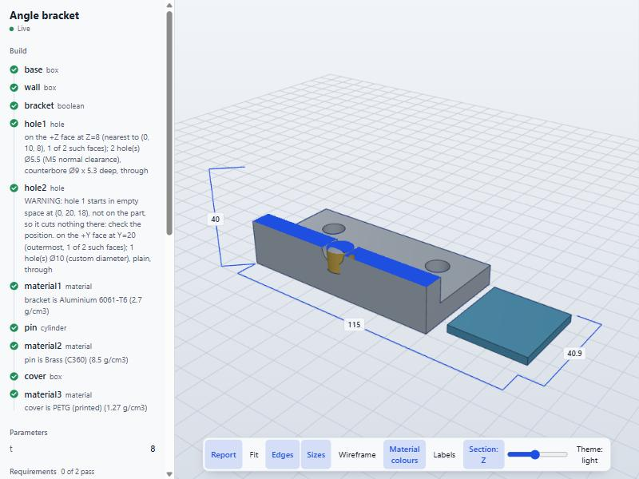
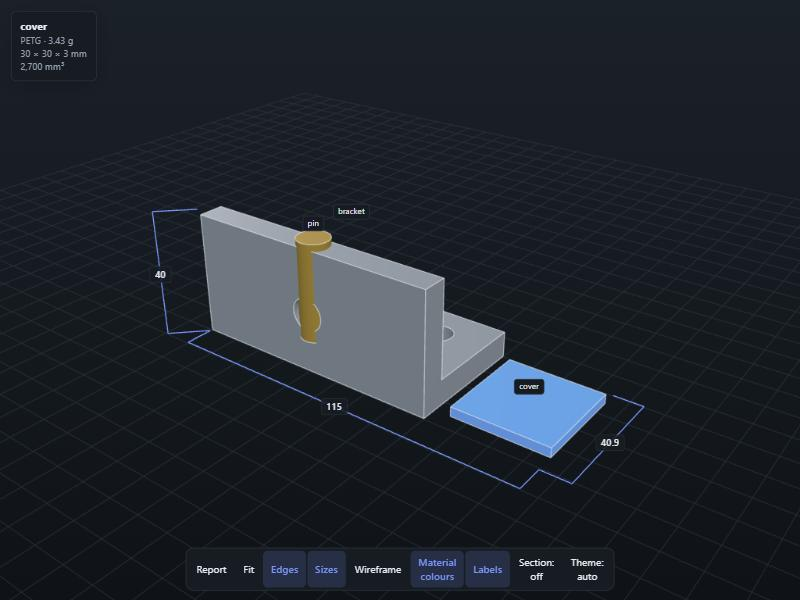

# Contrapt

**Open-source, AI-drivable CAD and simulator that proves a design works before you build it.**

[](https://github.com/ToxinNozaki/Contrapt/actions/workflows/ci.yml)
[](LICENSE)

Contrapt is a lightweight parametric 3D CAD app with a built-in [Model Context Protocol](https://modelcontextprotocol.io)
server. An AI assistant (Claude, a local model, or any MCP client; ChatGPT over HTTP is untested) can model a part with exact geometry, check it
against requirements, run real finite-element and mechanism analyses on it, and hand you a Build Pack to make it, while
you watch live in a browser viewer. It is an open-source alternative to tools like Autodesk Inventor, built for
inventing, and it runs from a plain `npm install` (no Electron, no cloud, no licence server).



## The idea: the Proof Loop

Most AI-CAD tools stop at "the AI drew a shape". Contrapt makes the AI **prove** it:

1. **Requirements as code.** `add_spec` saves requirements with the model: `mass <= 60 g`, `deflection <= 2 mm at 50 N`,
   `no interference`, `fits the 70 mm slot`.
2. **Judged on the real geometry, after every change.** Every tool reply carries the live PASS/FAIL verdict with numbers.
3. **Optimise.** `optimize_param` sweeps a parameter against the specs on real rebuilds (the thinnest wall that still passes).
4. **Ship a Build Pack.** `build_pack` writes a README with the verdict, parts, parameters, requirements and Design
   Journal, plus STEP and STL for every part.

| Requirements panel (live in the viewer) | Section view |
|---|---|
|  |  |

## Quick start

Needs Node.js 22.18+.

```bash
git clone https://github.com/ToxinNozaki/Contrapt.git
cd Contrapt && npm install
npm run demo -w @contrapt/mcp     # sample bracket in the live viewer
```

Connect your AI (Claude Code, Claude Desktop, LM Studio, ...): step by step in [docs/SETUP.md](docs/SETUP.md). For Claude
Code it is one line:

```bash
claude mcp add contrapt -- node /path/to/Contrapt/packages/mcp/src/cli.ts
```

Then try: *"Use the `proof_loop` playbook: a 100 mm aluminium cantilever arm, 20 mm wide, must carry 50 N at the tip with a
safety factor of 2 and less than 2 mm droop. Find the lightest thickness that passes, then make the Build Pack."*

## What it can do (47 tools)

| Area | Tools |
|---|---|
| **Model** | `add_step`, `run_script`, `set_param`, `suppress_step`, `remove_step`, `get_model`, `measure`, `save_model`, `load_model`, `view`, `render_view` |
| **Geometry** | exact OpenCASCADE solids: box, cylinder, sphere, sketch (plain or **constrained**), extrude, revolve, loft, sweep, fillet, chamfer, shell, booleans, holes (metric sizes, counterbore, countersink), patterns, mirror, **face-relative placement**, `mate` |
| **Materials** | 18 materials (with typical thermal properties), `material` step, mass in every report, `mass_properties` (centre of mass, inertia tensor, inertia about any axis) |
| **Assemblies** | `check_interference`, `check_assembly`, `bom`, `motion_check` |
| **Hand calculations** | `section_properties`, `beam_check`, `column_check` |
| **Simulation** | `frame_analysis`, `frame_modes`, `frame_buckling` (3D beam FEA); `solid_fea` (body-fitted solid FEA), `solid_modes` (natural frequencies of solids), `thermal_analysis` (steady-state conduction and convection with thermal stress); `mechanism_sweep`, `fourbar_check` (linkage kinematics); `dynamics_sim` (1-DOF dynamics) |
| **Manufacturing** | `print_check` (FDM overhangs, orientation, thin walls), `drawing` (SVG sheet with three views, dimensions, title block), `export_model` (STEP, STL) |
| **Proof Loop** | `add_spec`, `remove_spec`, `check_specs`, `optimize_param`, `journal_add`, `get_journal`, `build_pack` |
| **Other CAD** | `inspect_file`, `import_file` (STEP), `convert_file` (optional converter; Inventor parts verified) |
| **Knowledge** | 18 engineering packs and 11 playbooks via `list_knowledge`, `get_knowledge`, `get_playbook` (also MCP prompts and resources) |

The viewer adds click-to-select with a mass/size card, a section plane, colour by material, labels, a light/dark switch
and the live Requirements and Design Journal panels.



## How far to trust the numbers

Every analysis is checked in the test suite against a closed form or a handbook value, and every reply says what kind of
number it is (measured, FEA, hand estimate).

| Capability | Checked against |
|---|---|
| Geometry, volume, mass, interference, gaps | exact kernel results; analytic volumes |
| Section properties | textbook rectangle, circle, tubes, L-angle |
| Frame FEA, static | cantilever, simply supported, fixed-fixed, torsion, axial, gravity: matches beam theory to 1e-9 |
| Frame modes / buckling | Euler-Bernoulli frequencies (0.5%); Euler column loads for four end conditions (0.5%) |
| Solid FEA | slender cantilever and axial bar vs beam and bar theory (within 0.5%); the frame solver; plate with a hole vs the handbook stress-concentration factor (within 1.5% at 5 elements per radius, 4% at 2.5) |
| Mechanisms | slider-crank position at every pose; four-bar sweep vs closed-form rocker swing and transmission angle |
| Solid modes | cantilever bending frequencies vs Euler-Bernoulli (within 1%), round and rectangular sections |
| Thermal | slab, internal generation, convecting fin and curved tube wall against closed forms; thermal stress against sigma = E alpha dT (161.0000 MPa vs 161) |
| Dynamics | pendulum periods (including the 90-degree elliptic case), DC-motor spin-up, damped spring-mass, Coulomb friction stop |
| Mass properties | box, cylinder, sphere, drilled plate closed forms |

**Limits, stated plainly.** No transient thermal, radiation, fluid, fatigue or contact analysis; no multi-body dynamics; solid FEA uses a
fitted *structured* hexahedral grid (sharp corners and features thinner than about two elements are not captured, and peak
stress at singular corners or under point loads keeps growing with refinement, so refine and compare); linear elastic and
small deflection throughout; beam specs in the Proof Loop are closed-form estimates; drawings carry overall dimensions
only; no sheet-metal modelling or DXF/PDF output yet. Material values are typical, so use the supplier datasheet for
anything that matters, and have a qualified engineer review anything that can hurt someone if it fails.

## Development

```bash
npm run ci          # lint, typecheck, all tests (300+)
npm run smoke:pack  # build the publishable package and run it from a clean install
```

TypeScript monorepo (npm workspaces): `packages/core` (kernel, solvers), `packages/mcp` (server, tools, knowledge),
`packages/viewer` (browser client), `packages/contrapt` (the publishable bundle). Read [CLAUDE.md](CLAUDE.md) and
[docs/HANDOFF.md](docs/HANDOFF.md) first; the feature ledger is [docs/FEATURES.md](docs/FEATURES.md), the edit log
[docs/EDITLOG.md](docs/EDITLOG.md), design notes [docs/DESIGN.md](docs/DESIGN.md), plans [docs/ROADMAP.md](docs/ROADMAP.md).
A sample drawing sheet is in [docs/images/sample-drawing.svg](docs/images/sample-drawing.svg).

## License

MIT, see [LICENSE](LICENSE). Third-party components are listed in [NOTICE.md](NOTICE.md).
Not affiliated with Autodesk, Anthropic, or OpenAI.
